

  <a href="https://www.miheerjangale.co.in">
    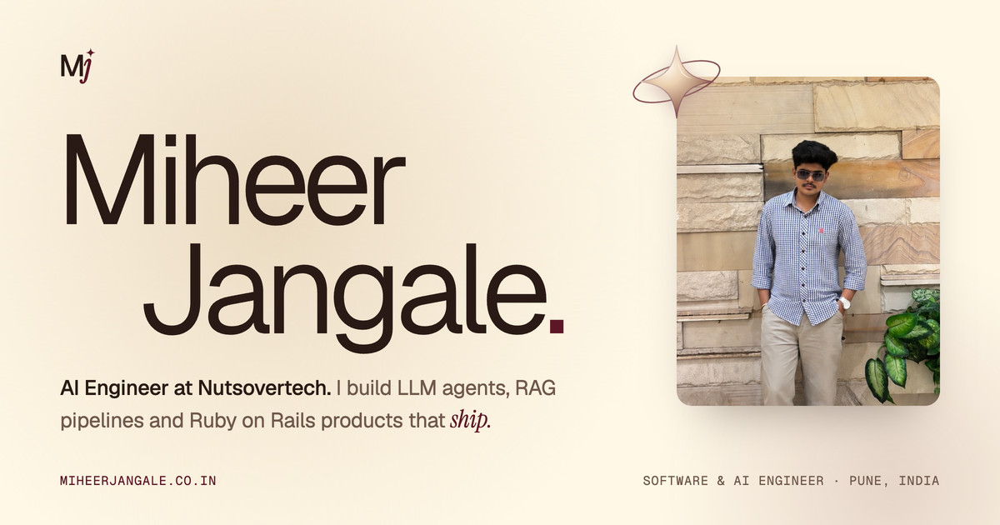
  </a>

  <a href="https://www.miheerjangale.co.in"><b>miheerjangale.co.in</b></a>
  &nbsp;·&nbsp;
  <a href="https://linkedin.com/in/miheer-jangale">LinkedIn</a>
  &nbsp;·&nbsp;
  <a href="https://github.com/miheer2003">GitHub</a>
  &nbsp;·&nbsp;
  <a href="mailto:miheerjangale7@gmail.com">Email</a>

This is the code behind my portfolio. I'm an AI Engineer at Nutsovertech in Pune, building LLM agents, RAG pipelines and Ruby on Rails products. The site is one page with a few interactive pieces, and each of them is built to stay smooth on laptops and phones.

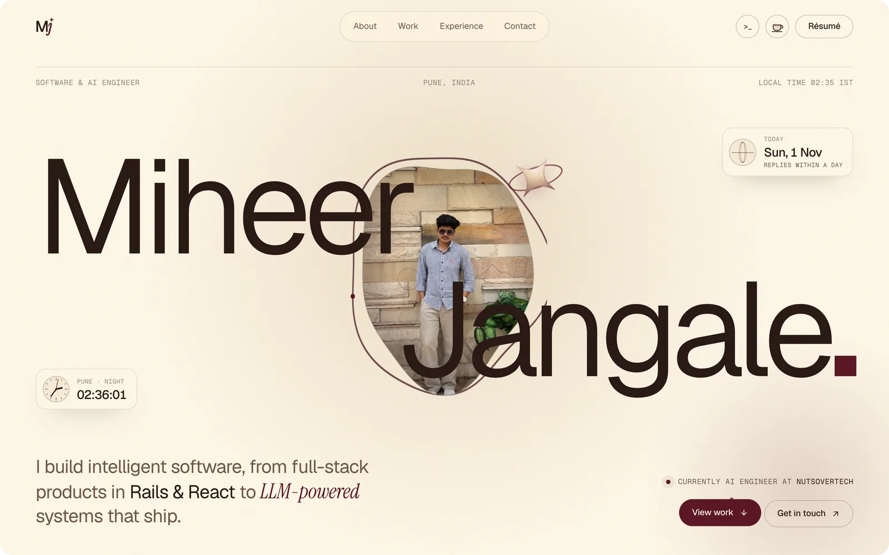

## What's on the page

| Section | What it does |
|---|---|
| Loader | A 3D word drum turns through Engineer, Builder, AI Engineer and Miheer. At 100% the orbiting star flies into the hero photo and the screen opens like blinds. |
| Hero | My name around a WebGL portrait that bends as you scroll, with a live Pune clock and today's date. |
| Scroll star | The star from the loader follows you down the page and rests in the section titles. |
| About | A three.js neural network that spins with scroll and fires when you click or tap it. |
| Work | Six projects, each with a drawn cover that follows the cursor, and a live GitHub contributions row. |
| What I do | Extruded letters and cards that tilt with the pointer, or with scroll on touch screens. |
| Experience | A rolodex timeline that turns as you scroll. |
| Numbers | My All India Rank, live GitHub contributions and results from my internship, rolled in on odometer digits. |
| Stack | A keycap board drawn on canvas. Hover, click or type a letter to press a tool, press Enter to ship it, and scroll to send light across the keys. |
| Proof of practice | An endless 3D deck of seven certificates. Drag or swipe through it and flip the top card. |
| Contact | 3D letters, email, phone and links. |
| Terminal | Press `` ` `` or the `>_` button to open a small terminal. Try `help`, `projects`, `skills` or `resume`. |
| Buy me a coffee | The cup in the navbar opens a UPI payment: a QR code on laptops, app links on phones. |

<table>
  <tr>
    <td width="50%">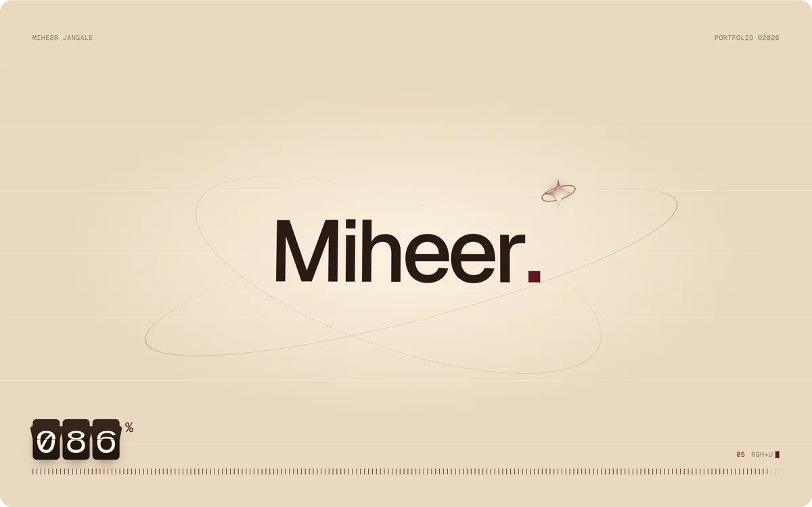
Loader
</td>
    <td width="50%">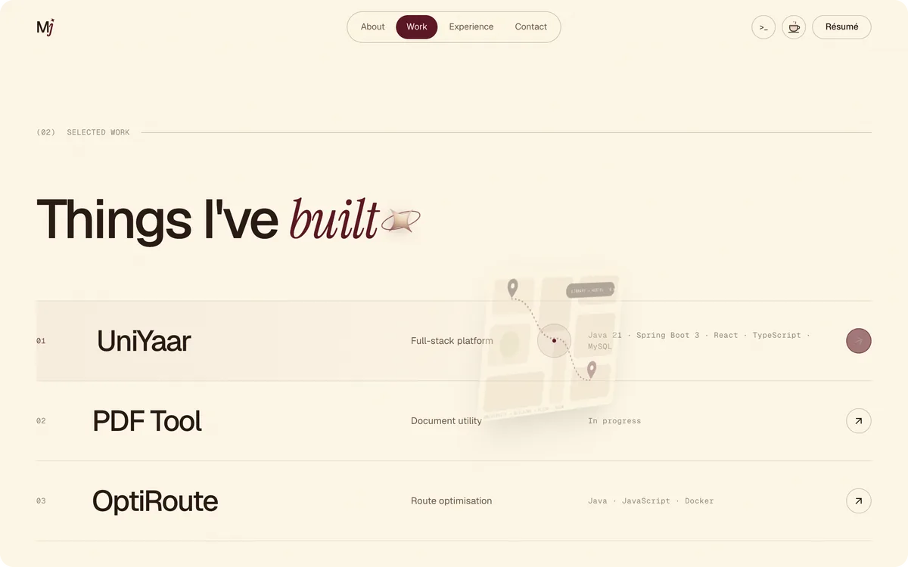
Work
</td>
  </tr>
  <tr>
    <td width="50%">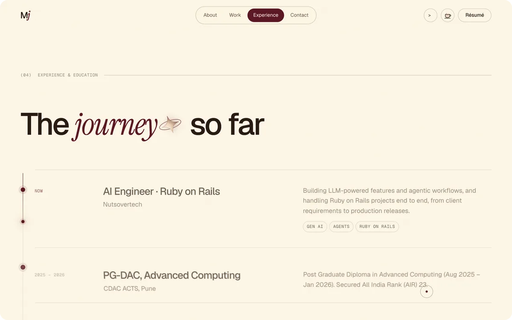
Experience
</td>
    <td width="50%">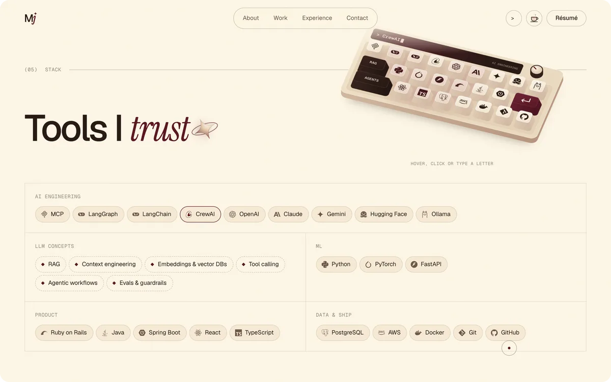
Stack
</td>
  </tr>
  <tr>
    <td width="50%">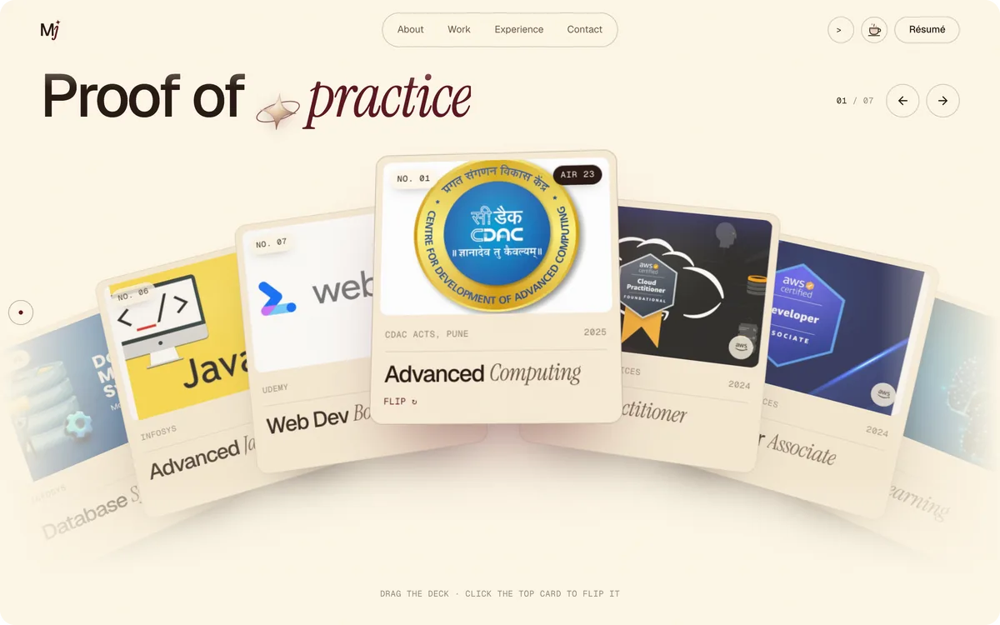
Proof of practice
</td>
    <td width="50%">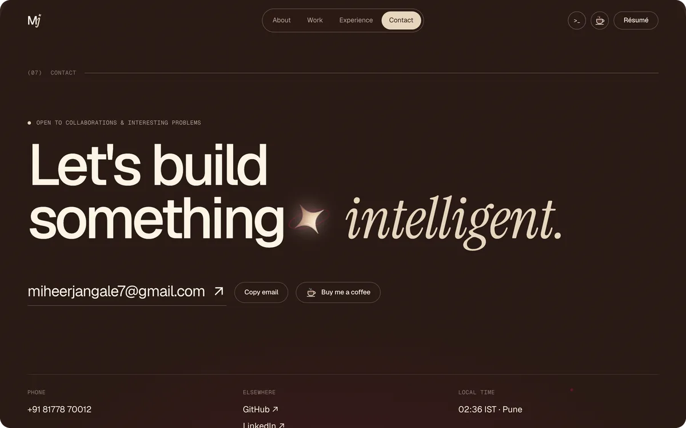
Contact
</td>
  </tr>
</table>

On phones, the pointer effects become taps, swipes and scrolling, and each project shows its cover inside the list.

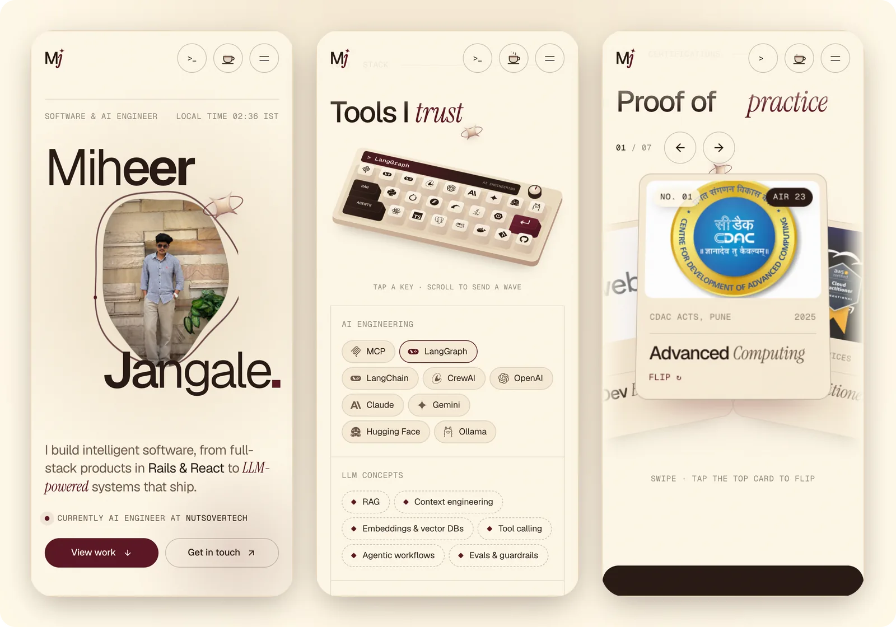

## Built with

React 18 · TypeScript · Vite · GSAP with ScrollTrigger and SplitText · Lenis · three.js · Canvas 2D · react-icons · Vercel

## How it's built

- **Structure.** `src/components/` has one component and one stylesheet per section. Links and projects live in `src/data/profile.ts`, so the page and the terminal share them.
- **GitHub data.** `api/github.ts` is a Vercel function that returns my contribution calendar and latest repos, cached for an hour, so the browser never calls GitHub directly.
- **Performance.** Animations change only `transform` and `opacity`. The canvas and WebGL scenes draw only while they are on screen. Scrolling was tested at 60 fps at 1440, 1366, 1280, 390 and 360 px widths.
- **Touch and reduced motion.** Pointer effects run only with a mouse or trackpad, and touch screens get scroll-driven versions. With reduced motion turned on, every effect has a still version.
- **Search and AI crawlers.** The page text, structured data (Person and ProfilePage) and share tags are in the first HTML response, so crawlers that don't run JavaScript can still read the site. `llms.txt` gives AI tools a short summary.

## Brand

<picture>
  <source media="(prefers-color-scheme: dark)" srcset="brand/PNG/logo/Mj-logo-for-dark-bg.png">
  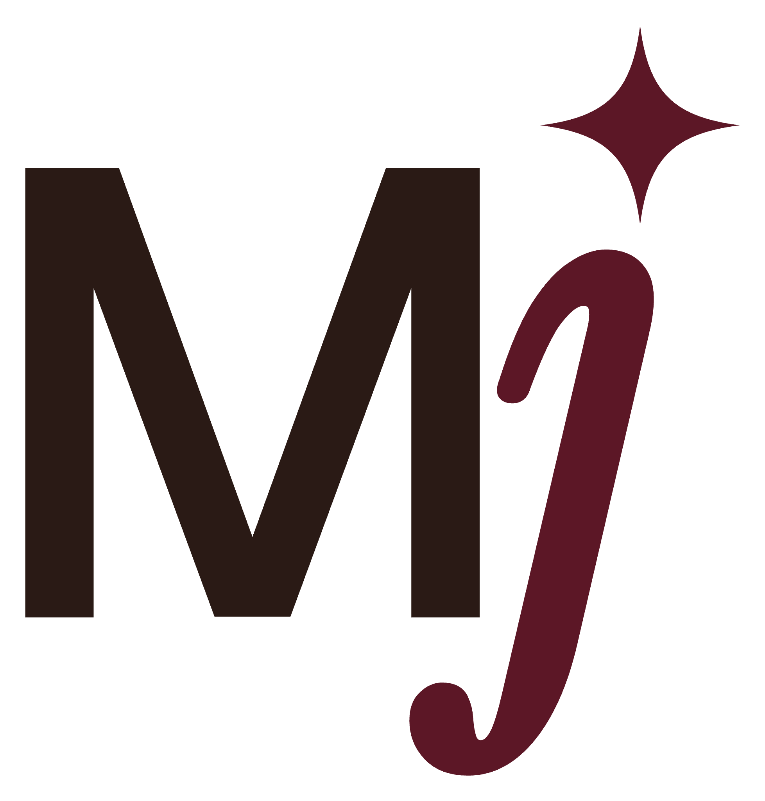
</picture>

The Mj logo pairs a Geist M with an Instrument Serif italic j whose dot is the site's four-point star. Every version of the logo, in PNG and SVG, is in [`brand/`](brand).

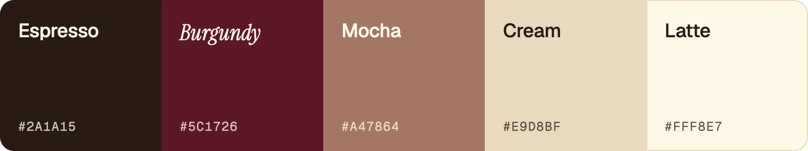

## Credits

The first version of this site started from [Moncy Yohannan's portfolio](https://github.com/MoncyDev/Portfolio-Website). It has since been redesigned and rewritten. Fonts: Geist and Geist Mono by Vercel, and Instrument Serif by Instrument, all under the SIL Open Font License. Icons come from Simple Icons, Font Awesome and Material Design Icons through react-icons.
