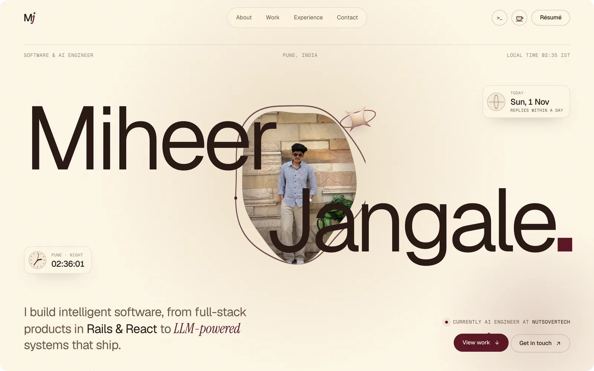
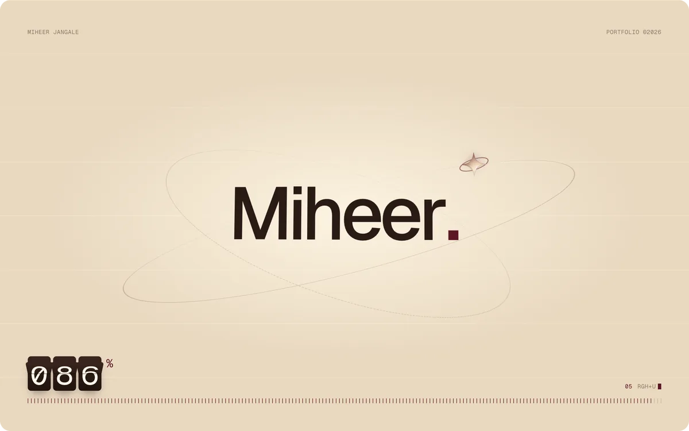
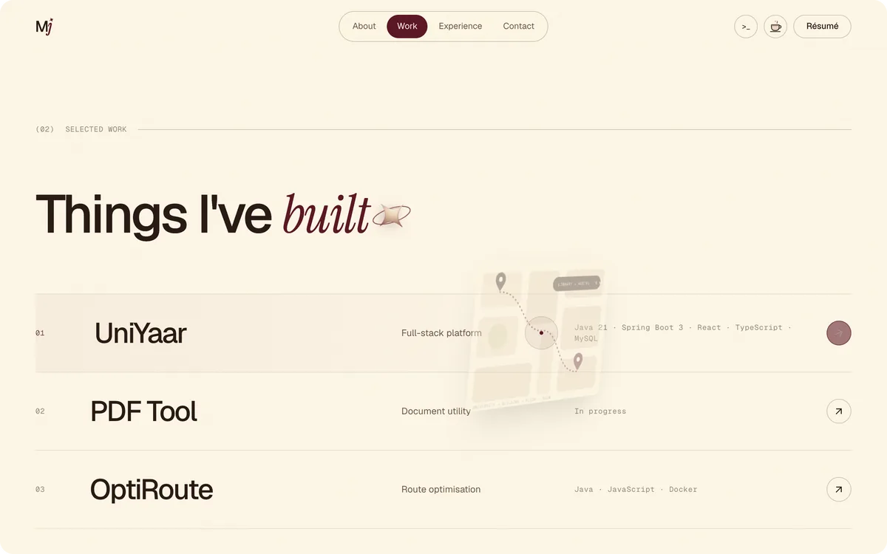
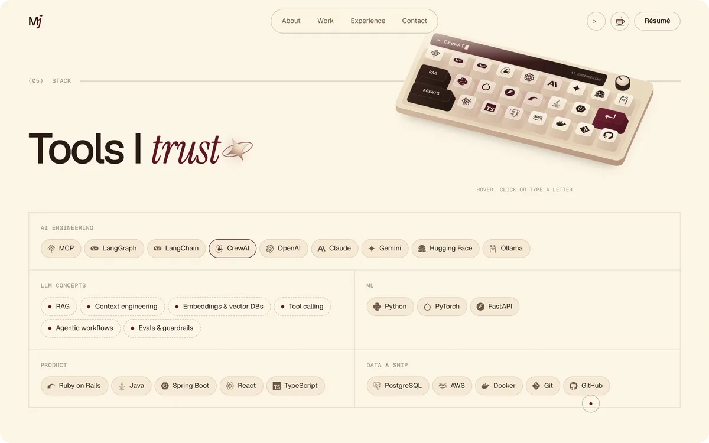
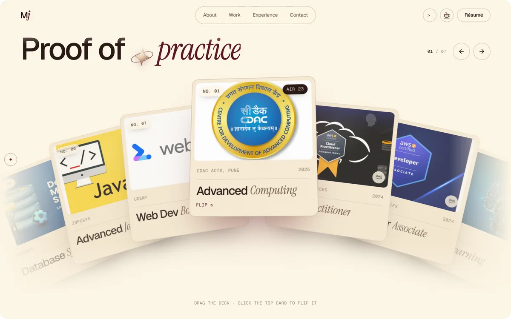
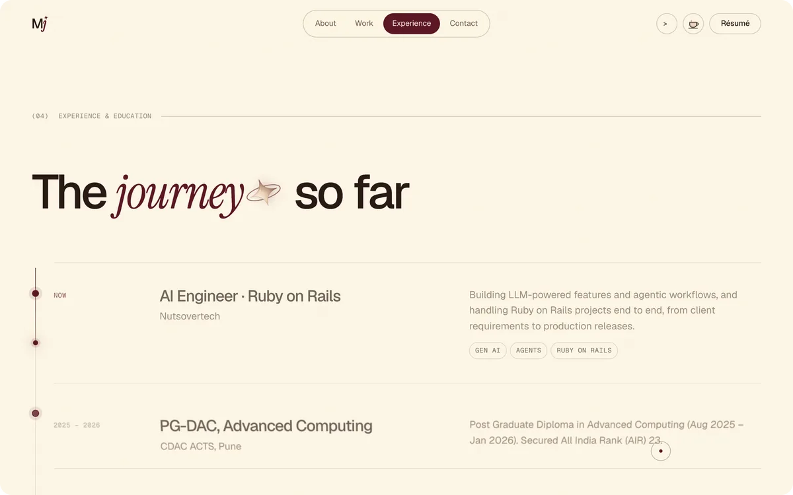
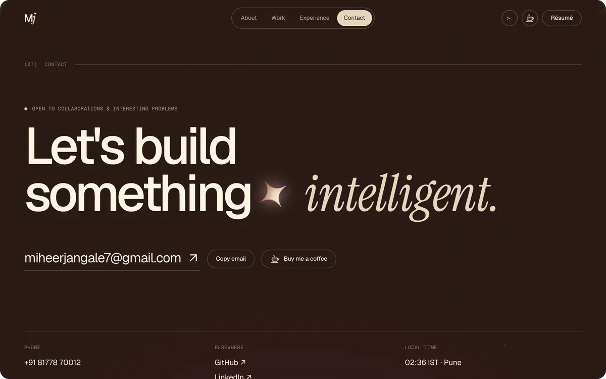
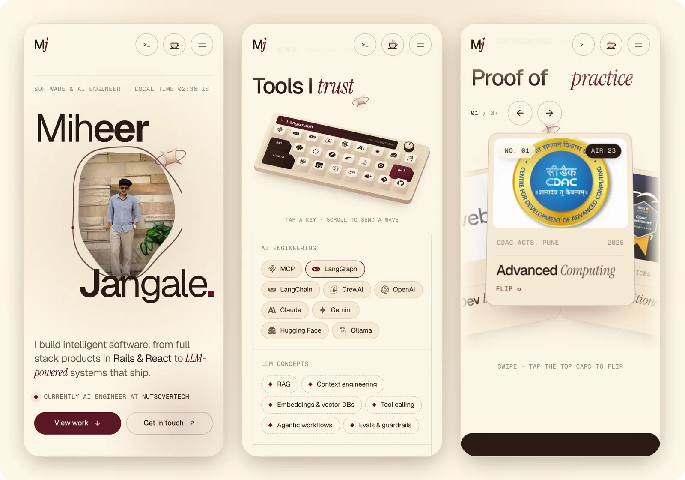
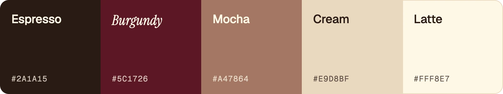

<div align="center">

# ⚡ MIHEER JANGALE
### AI Engineer & Full-Stack Systems Builder
**Pune, Maharashtra, India**

<br/>

[](https://www.miheerjangale.co.in)
[](https://www.miheerjangale.co.in)
[](https://www.miheerjangale.co.in)
[](https://linkedin.com/in/miheer-jangale)
[](https://github.com/miheer2003)

<br/>

[](https://react.dev/)
[](https://www.typescriptlang.org/)
[](https://vitejs.dev/)
[](https://threejs.org/)
[](https://greensock.com/gsap/)
[](https://lenis.darkroom.engineering/)
[](https://rubyonrails.org/)
[](https://www.oracle.com/java/)
[](https://www.python.org/)

<br/>

<a href="https://www.miheerjangale.co.in">
  
</a>

<br/><br/>

**An ultra-responsive, highly interactive 3D personal portfolio engineered with React 18, TypeScript, Three.js, Canvas 2D, and GSAP. Blends creative WebGL visuals, real-time terminal emulation, physical keycap interactions, and 60 FPS momentum scrolling.**

[Explore Live Experience 🌐](https://www.miheerjangale.co.in) • [Launch In-Browser Terminal 💻](#-in-browser-developer-terminal) • [Explore Projects 📁](#-featured-engineering-work) • [Architecture ⚡](#-performance--engineering-feats)

</div>

---

## 🌟 Executive Overview

This repository houses the complete source code for **[miheerjangale.co.in](https://www.miheerjangale.co.in)**. Engineered to eliminate static resume monotony, this portfolio acts as a living showcase of high-concurrency systems, AI agent workflows, and tactile visual computing.

### 💎 Key Highlights

- 🖥️ **Interactive Embedded Terminal**: Built-in interactive CLI triggered via the `` ` `` key or floating `>_` widget with shell commands (`whoami`, `projects`, `skills`, `github`, `sudo`, `coffee`).
- ⌨️ **Interactive Canvas Mechanical Keycap Board**: Custom 2D/3D canvas keyboard where users can physically type or click keys to illuminate skills with wave ripple lighting.
- 🧠 **3D Neural Network (Three.js)**: Interactive synapsing neural mesh in the About section that rotates with scroll and fires energy pulses upon cursor click or tap.
- 🖼️ **Deformable WebGL Hero Portrait**: Mesh displacement reacting to user scroll momentum paired with a live-synced Pune timezone clock and date widget.
- 🎴 **Physics-Driven 3D Certificate Deck**: Endless stacked 3D card carousel with interactive drag gestures, swipe velocity, and card-flip inspection.
- 📈 **Dynamic Odometer Metric Counters**: Numeric roller animations tracking All India Rank 23 (CDAC PG-DAC), live GitHub stats, and internship throughput.
- ☕ **Native UPI / Buy Me a Coffee Gateway**: Dynamic modal generating instant UPI QR codes on desktop and native payment deep-links on mobile devices.
- ⚡ **60 FPS Hardware-Accelerated Motion**: Custom integration coupling Lenis smooth scrolling with GSAP `ScrollTrigger` directly on the requestAnimationFrame ticker.

---

## 📸 Visual Showcase

<table align="center" width="100%">
  <tr>
    <td width="50%" align="center">
      
      <p><sub><b>01. 3D Kinematic Loader & Blind Reveal</b></sub></p>
    </td>
    <td width="50%" align="center">
      
      <p><sub><b>02. Curated Projects with Cursor-Tracking Art</b></sub></p>
    </td>
  </tr>
  <tr>
    <td width="50%" align="center">
      
      <p><sub><b>03. Interactive Mechanical Keycap Canvas</b></sub></p>
    </td>
    <td width="50%" align="center">
      
      <p><sub><b>04. Physics-Based 3D Certificate Carousel</b></sub></p>
    </td>
  </tr>
  <tr>
    <td width="50%" align="center">
      
      <p><sub><b>05. Scrub-Triggered Rolodex Timeline</b></sub></p>
    </td>
    <td width="50%" align="center">
      
      <p><sub><b>06. Magnetic Social Controls & Direct Reach</b></sub></p>
    </td>
  </tr>
</table>

---

## 💻 In-Browser Developer Terminal

Press `` ` `` (backtick) or tap the floating **`>_`** button in the bottom right corner anywhere on the site to launch the built-in terminal emulator.

```bash
$ miheer --status
> AI Engineer @ Nutsovertech | Building Agentic Systems, RAG Pipelines & Scalable Backends

$ miheer whoami
> Miheer Jangale — CDAC PG-DAC AIR 23 | B.Tech Computer Engineering (First Class)

$ miheer projects --highlight
> [01] UniYaar         Java 21 · Spring Boot 3 · React · TypeScript · MySQL
> [02] JobHunt Agent   Python · Claude · Gemini · Ollama · ATS Automations
> [03] AirLight        Python · MediaPipe · OpenCV · IoT Tuya Integration
> [04] OptiRoute       Java · Spring Boot · Route Optimisation · Docker

$ miheer coffee
> Opening instant UPI payment gateway... ☕
```

### Supported Commands
`whoami` · `projects` · `skills` · `experience` · `github` · `contact` · `resume` · `coffee` · `ls` · `cd <section>` · `date` · `clear` · `sudo`

---

## 🧭 Page Architecture & Interactive Systems

| Section | Engineering Stack | Interactive Experience |
|---|---|---|
| **Loader** | Three.js + Canvas 2D + GSAP | 3D word drum rotating through *Engineer*, *Builder*, and *AI Engineer*. At 100%, an orbiting star particle launches into the portrait and triggers a Venetian-blind transition. |
| **Hero** | WebGL Shader + Canvas + GSAP | Deformable mesh portrait reacting to scroll momentum with live-synced Pune timezone clock and date widget. |
| **Scroll Star** | Kinetic Particle Engine | The ambient star from the loader dynamically navigates down the page, landing precisely inside each section title as you scroll. |
| **About** | Three.js + Custom Shaders | Interactive 3D neural network that spins continuously with scroll and discharges electrical synaptic bursts upon user tap or click. |
| **Work** | React + SVG Filter Canvas | Six production systems featuring custom vector cover art that tilts with the pointer, coupled with a live GitHub activity row. |
| **What I Do** | 3D Perspective CSS + Touch Matrix | Dual cards with dashed neon borders and interactive tilt physics detailing full-stack architecture and AI systems. |
| **Experience** | GSAP Scrubbing Rolodex | Scrub-driven timeline animating through academic milestones (PG-DAC AIR 23, B.Tech, Diploma) and software engineering internships. |
| **Metrics / Numbers** | Odometer Rolling Physics | Dynamic number counters rolling in on impact: All India Rank 23, GitHub contributions, and internship query optimizations. |
| **Tech Stack** | Canvas 2D Mechanical Simulation | Interactive keycap keyboard. Type on your physical keyboard or click keys to depress mechanical caps, trigger soundless ripple waves, or hit Enter to ship. |
| **Proof of Practice** | 3D CSS Card Deck | Endless 3D stacked deck of 7 professional credentials (AWS Cloud, Machine Learning, Database Architecture). Drag, swipe, or click to flip. |
| **Contact** | Spring Physics + CSS Variables | Magnetic spring-physics social buttons tracking cursor coordinates, direct mailto, tel link, and instant resume download. |
| **UPI Gateway** | Dynamic QR Generation + Deep-Links | Instant coffee donation modal generating real-time UPI QR codes on desktop and native mobile URI handlers (`upi://pay`). |

---

## 🛠️ Technology Stack

<div align="center">

### AI & Agentic Systems


### Creative Frontend & WebGL


### Backend & Cloud Infrastructure


</div>

---

## 🚀 Featured Engineering Work

### 01. [UniYaar](https://github.com/miheer2003/Uni-Yaar)
> **Full-Stack Student Collaboration & Resource Ecosystem**
- Built with **Java 21, Spring Boot 3, React, TypeScript, and MySQL**.
- Multi-tier REST services, JWT stateful authentication, and responsive client architecture.

### 02. [JobHunt Agent](https://github.com/miheer2003/JOB-HUNT-Automation-With-AI)
> **Autonomous AI Job Application & Resume Matching Pipeline**
- Powered by **Python, Claude API, Google Gemini, Ollama, and ATS Integration APIs**.
- Automates job discovery, customizes resumes against job requirements using LLMs, and triggers automated submission workflows.

### 03. [AirLight](https://github.com/miheer2003/Air-Light)
> **Touchless Spatial Computer Vision & Smart Home IoT Controller**
- Engineered using **Python, MediaPipe, OpenCV, Flask, and Tuya IoT APIs**.
- Contactless hand landmark detection translating 3D gestures into ambient hardware lighting commands.

### 04. [Task Manager API](https://github.com/miheer2003/Task-Manager)
> **Production-Ready Enterprise Task Orchestration Backend**
- Developed with **Java, Spring Boot 3, Hibernate, MySQL, and OpenAPI 3.0 Documentation**.
- Features strict validation, audit logging, role-based access control, and complete CRUD endpoints.

### 05. [OptiRoute](https://github.com/miheer2003/OptiRoute)
> **Heuristic Logistics & Fleet Route Optimization Engine**
- Built with **Java, JavaScript, and Docker**.
- Algorithmic route minimization reducing transit times and fuel expenditures across complex dispatch topologies.

### 06. [PDF Tool](https://github.com/miheer2003/PDF-Tool)
> **High-Performance Document Utility & Processing Pipeline**
- Fast client-side and server-side document parsing, page extraction, conversion, and watermarking engine.

---

## ⚡ Performance & Engineering Feats

- **Strict 60 FPS Animation Budget**: All visual motions are GPU-accelerated, modifying exclusively `transform` and `opacity` properties to prevent DOM reflows and paint thrashing.
- **Off-Screen WebGL Pausing**: Canvas and Three.js render loops pause automatically via `IntersectionObserver` when scrolled outside the active viewport, conserving GPU memory and battery.
- **Serverless GitHub Edge Caching**: The [`api/github.ts`](api/github.ts) edge handler pulls commit calendars and repositories, serving cached data to prevent client-side GitHub rate limits.
- **Lenis Smooth Momentum Sync**: GSAP `ScrollTrigger` and Lenis scrolling are unified via `gsap.ticker.add`, ensuring zero camera jitter across high-refresh monitors (120Hz/144Hz).
- **SEO & Search Crawler Readiness**: Initial HTML contains structured Schema.org JSON-LD profiles (`Person`, `ProfilePage`), semantic meta tags, and an [`llms.txt`](public/llms.txt) manifest for AI search agents.

---

## 📱 Adaptive Mobile Architecture

On mobile devices and touch displays:
- Mouse pointer effects gracefully convert into intuitive touch-swipe gestures and scroll-driven physics.
- The 3D certificate deck adapts to finger flick velocity.
- The interactive mechanical keycap board scales seamlessly to touch screens.
- Interactive project tiles embed visual cover art inline within the list for effortless mobile browsing.

<div align="center">
  
</div>

---

## 🎨 Design System & Palette

The visual identity is anchored around an intentional warm-vintage palette:

| Name | Hex Code | Purpose |
|---|---|---|
| **Espresso** | `#2A1A15` | Deep grounding contrast & typography |
| **Burgundy** | `#5C1726` | Accent borders, badges & focal points |
| **Mocha** | `#A47864` | Subheadings, secondary badges & icons |
| **Cream** | `#E9D8BF` | Canvas backgrounds & subtle cards |
| **Latte** | `#FFF8E7` | Highlights & primary card surfaces |

<div align="center">
  
</div>

---

## 💻 Local Development

Clone and spin up the project locally in under two minutes:

### 1. Prerequisites
- **Node.js**: v18.0.0 or higher
- **npm** or **pnpm** / **yarn**

### 2. Clone the Repository
```bash
git clone https://github.com/miheer2003/PortFolio.git
cd PortFolio
```

### 3. Install Dependencies
```bash
npm install
```

### 4. Start Development Server
```bash
npm run dev
```
Navigate to `http://localhost:5173` to explore the site with live hot module replacement.

### 5. Build for Production
```bash
npm run build
```
Generates a minified, tree-shaken, and production-optimized bundle inside the `dist/` directory.

---

## 📬 Connect With Me

<div align="center">

**Miheer Jangale**  
*AI Engineer · Full-Stack Systems Builder*  
Pune, Maharashtra, India

[](https://www.miheerjangale.co.in)
[](https://linkedin.com/in/miheer-jangale)
[](https://github.com/miheer2003)
[](mailto:miheerjangale7@gmail.com)

<br/>

<sub>Designed & Engineered with precision by <b>Miheer Jangale</b></sub>

</div>
